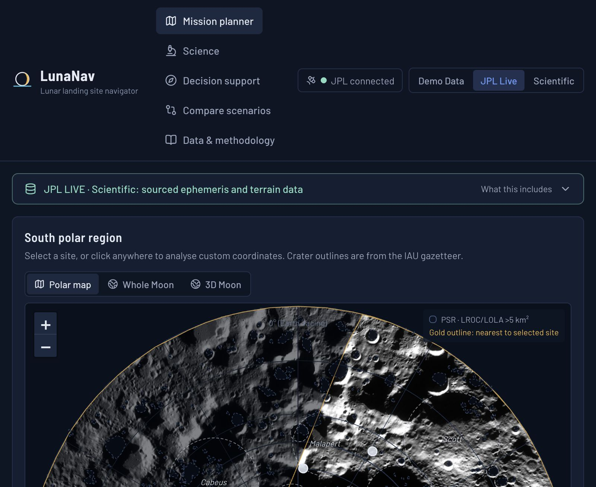
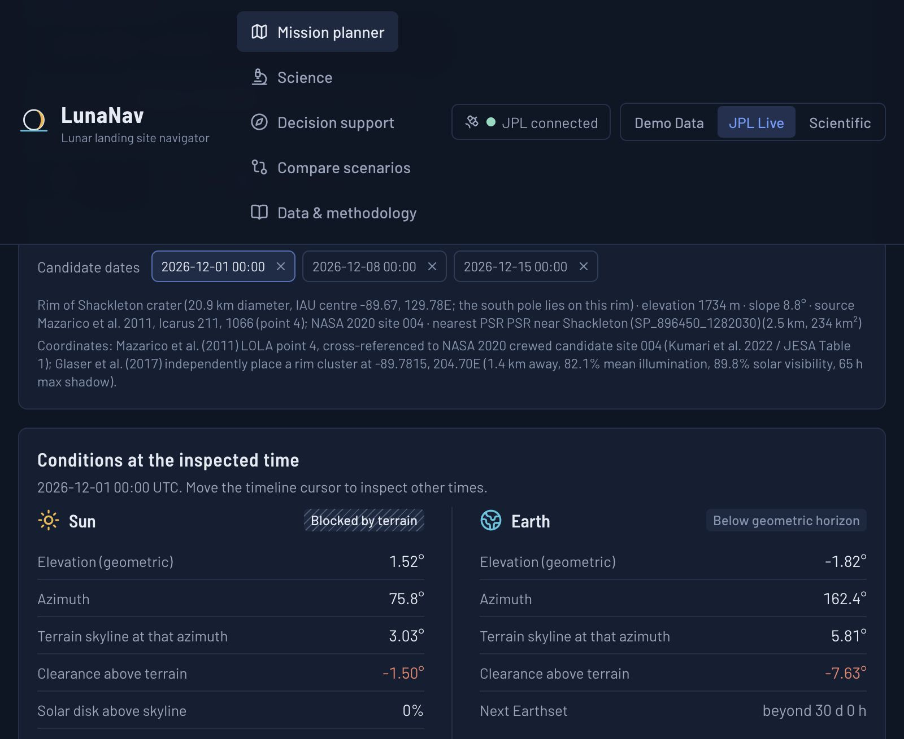
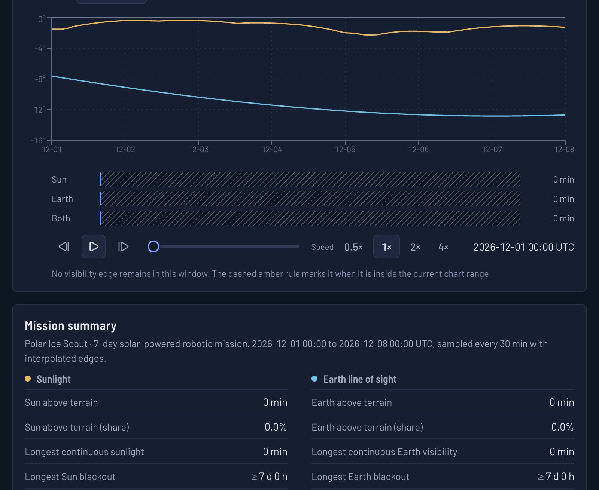
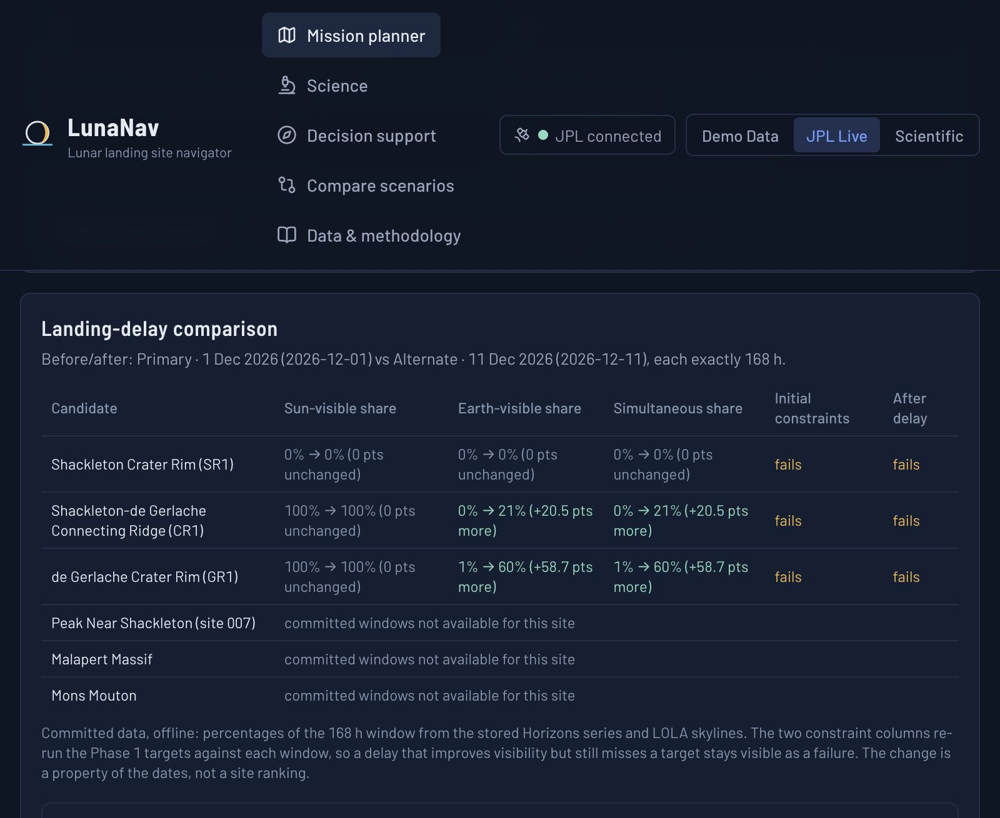
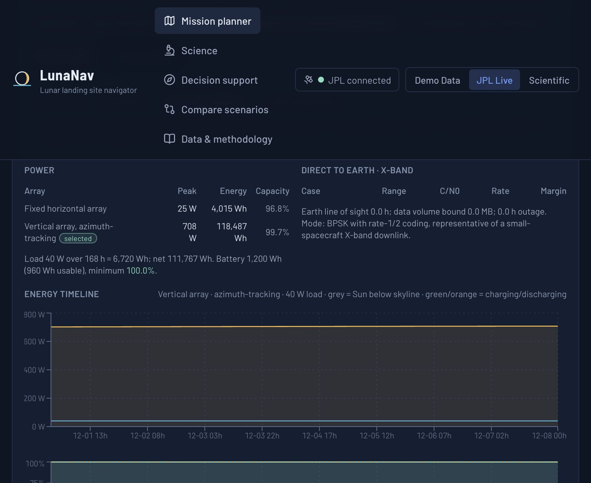
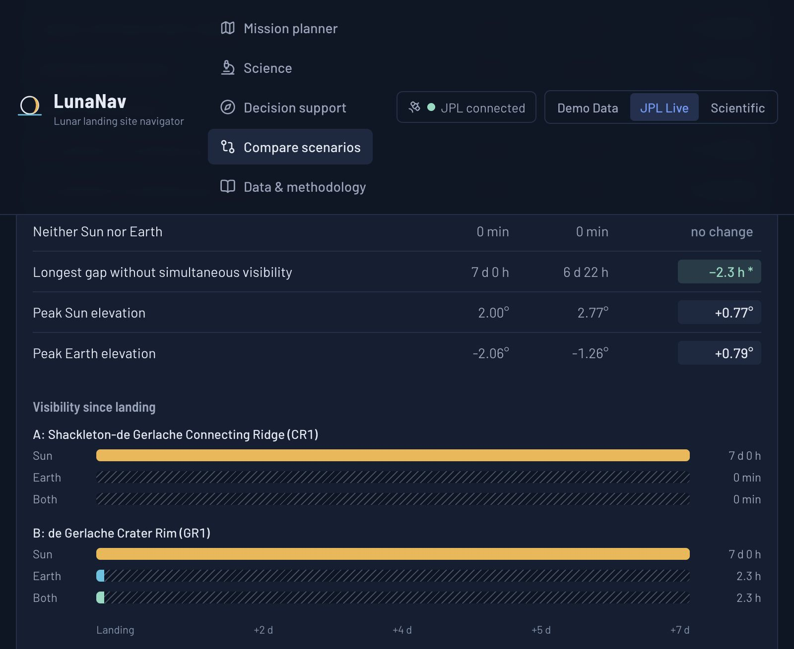
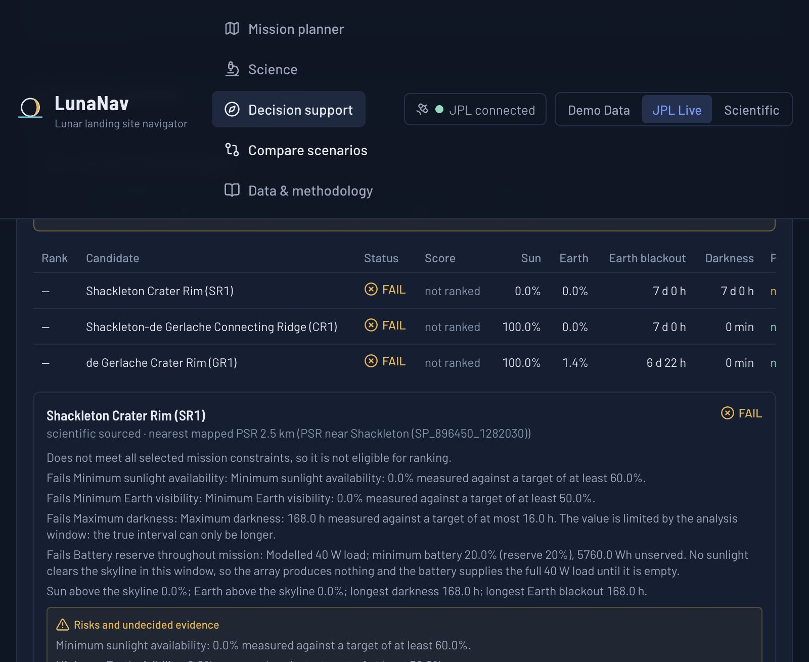
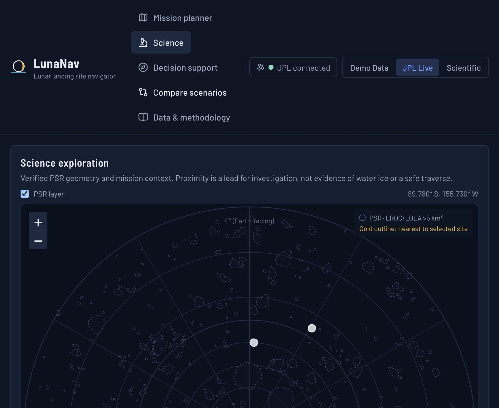

# LunaNav — Lunar Landing Site Navigator

> **Status (14 Nov 2026):** verified local release candidate. The backend, frontend, scientific checks and Phase 4–6 browser matrices pass. A public deployment, demonstration video and official NASA submission are still pending — see [docs/PHASE7_FINAL_VALIDATION.md](docs/PHASE7_FINAL_VALIDATION.md).

A lunar landing-site visibility explorer, built for the NASA Space Apps Challenge 2026 problem *Lunar Landing Site Navigator*.

Pick a site near the lunar south pole (or click anywhere on the polar map), choose a landing date and mission length, and LunaNav shows when the Sun and Earth are above the **terrain** horizon, not just above a flat one. You can compare two site/date scenarios side by side, or see what changes if a landing slips.

Every result carries a provenance label. Three modes:

- **JPL live** (default): Sun/Earth positions fetched live from **NASA JPL Horizons**, plus LRO imagery and LOLA elevation from **NASA/JPL Moon Trek** on the polar map, the whole-Moon map and a **3D Moon** lit by the real Sun direction. Visibility calculations apply terrain only where LOLA masks exist; otherwise results say "geometric only".
- **Demo data**: built-in approximate ephemeris over **synthetic** terrain skylines. Works offline.
- **Scientific**: JPL Horizons + LOLA terrain masks, and refuses to compute if either is missing.

### The problem

Near the lunar south pole the Sun stays close to the horizon, so terrain can hide it for long periods. Earth can also be below the local skyline even when a flat-horizon model says it is visible. A useful landing-site tool must compare sunlight, direct-to-Earth geometry, mission timing and science context without pretending those measurements are a flight-certification or landing-safety decision.

### Our solution

LunaNav puts the measured trade-offs in one browser workspace: select a site and date, inspect terrain-adjusted visibility, compare sites or a delayed landing, tune mission requirements, and explore nearby PSRs with explicit uncertainty and water-ice limits. Every result carries its source and model label, and missing data stays missing.

### Technology

FastAPI, Pydantic and NumPy on the backend; React 19, TypeScript and Vite on the frontend; Leaflet for maps, Recharts for charts, and lazy-loaded Three.js for the optional 3D terrain and Moon views. Data stays as inspectable JSON; there is no database and no hidden service key.

For details on the JPL connection, see [docs/JPL_CONNECTION.md](docs/JPL_CONNECTION.md). To check it: `cd backend && python scripts/check_jpl.py`.

## Quick start

Requirements: Python 3.11+ and Node 20+.

```bash
# 1. Backend (http://localhost:8000, API docs at /docs)
cd backend
python -m venv .venv && source .venv/bin/activate   # Windows: .venv\Scripts\activate
pip install -r requirements.txt
uvicorn app.main:app --reload --port 8000

# 2. Frontend (http://localhost:5173), in a second terminal
cd frontend
npm install
npm run dev
```

The Vite dev server proxies `/api` to the backend, so no CORS or URL configuration is needed locally. Or run `./scripts/dev.sh`, which installs dependencies on first run and starts both.

### Deployment

Deployment is prepared for a Vercel static frontend and a Render Python API, with environment variables and a public-workflow checklist in [docs/DEPLOYMENT.md](docs/DEPLOYMENT.md). No public URL is recorded yet. Once deployed, set the frontend's `VITE_API_BASE` to the backend origin and the backend's `LUNANAV_CORS` to the frontend origin.

### Tests

```bash
cd backend && pytest          # 349 tests: coordinates, time, ephemeris vs Meeus, horizon logic,
                              # intervals, API contract, mission config and site-catalogue validation,
                              # site provenance and PSR geometry, requirement checks, comparison,
                              # rescheduler, mode switching, topocentric Horizons site az/el (Task 1),
                              # Task 2 series assembly, terrain inventory (Task 3), Task 5 data
                              # validation, Task 6 data access, two-tier horizon masks and the wide
                              # 80 m DEM, Phase 3 geometric Sun visibility and terrain-adjusted
                              # visibility from the committed data, the terrain horizon profile
                              # and the reproducible mission-report envelope, the Phase 4
                              # feasibility matrix, pooled site DEM previews, the Phase 5
                              # power and link budgets, energy trace and Markdown report,
                              # decision ranking, mission-delay power deltas, panel orientation
                              # and one-at-a-time sensitivity, JPL Horizons live provider,
                              # Moon Trek imagery and Phase 6 PSR/science context
cd frontend && npm test       # 52 Vitest/jsdom tests: projection, night, craters, PSR, zoom,
                              # interval bands, date validation, thresholds, candidate comparison,
                              # energy-timeline helpers, decision dashboard, delay comparison,
                              # 3D terrain shadows and next-transition selection
cd frontend && npm run build  # strict TypeScript + production bundle
cd frontend && npm run smoke  # real-browser workflow; needs both dev servers running and Chrome
cd frontend && npm run acceptance  # 13-test Phase 4 matrix; see docs/PHASE4_ACCEPTANCE.md
cd frontend && npm run acceptance:phase5  # 6-test Phase 5 matrix; see docs/PHASE5_ACCEPTANCE.md
cd frontend && npm run acceptance:phase6  # 8-test Phase 6 matrix; see docs/PHASE6_ACCEPTANCE.md
```

### Mid-project acceptance check (Phase 3, no frontend needed)

The terminal comparison the checkpoint asks for reads the committed Horizons series and
LOLA masks, prints both mission windows against the Phase 1 requirements, and writes
machine-readable JSON for Phase 4:

```bash
cd backend
python scripts/analyze_mission.py --start 2026-12-01 --days 7 --compare-all
python scripts/analyze_mission.py --start 2026-12-11 --days 7 --compare-all
```

Each run prints per-site sunlight, Earth line-of-sight, simultaneous visibility, longest
darkness and longest Earth blackout, the met/not-met verdict with the numerical reason,
and the delay delta. JSON goes to `backend/outputs/mission_comparison_<window>.json`.
A start date without a committed series is refused with the list of supported windows —
never filled with synthetic terrain or extrapolated ephemeris.

## What it does

| View | What you can do |
| --- | --- |
| **Mission planner** | Polar map with published candidate landing sites and click-to-pick custom coordinates; landing time (UTC) with the mission's initial/alternative date presets, and duration; saved candidate dates; Sun/Earth elevation, azimuth, terrain skyline, clearance, time to sunset/Earthset; 360° horizon panorama; scrubbable visibility timeline; mission summary metrics. Sites carry their LOLA elevation, slope and nearest permanently shadowed region (PSRs drawn on the map). |
| **Compare scenarios** | Two site/date/duration scenarios side by side with every metric, change highlighting, aligned visibility bands, and data-derived trade-off statements. The side-by-side view describes differences; it does not rank sites. |
| **Decision support** | Set five adjustable requirements and a priority preset; see PASS/FAIL/UNDECIDED per candidate, battery/power state, PSR context and a transparent ranking of only the eligible sites. This is a mission-preference comparison, not NASA approval or a landing-safety verdict. |
| **Science exploration** | PSR layer with a gold nearest-region outline, boundary/centroid distance and uncertainty, both committed mission windows, candidate comparison, six education topics, model labels and a no-overclaim water-ice contract. Nearby PSRs are investigation leads, not proof of ice or a safe route. |
| **Reschedule a mission** | Same site and duration, original vs proposed date: changes in sunlight, Earth visibility, simultaneous visibility, longest blackouts, requirement verdicts and — for the two committed windows — power and minimum-battery deltas. |
| **Lunar viewer** | Moon Trek imagery (LROC WAC, LOLA shaded relief or LOLA elevation) on three views: south polar map; zoomable whole-Moon 2D map with the night side and the Sun and Earth sub-points; 3D Moon shaped by LOLA elevation. All are lit by the Sun's position right now, or at the inspected mission time, and label craters from the IAU gazetteer. |
| **Data & methodology** | Calculation pipeline, providers per mode and their availability, which physical effects each includes, conventions, and what results do not mean. |

## Screenshots

Captured on 14 Nov 2026 from the local JPL-live build (see `assets/screenshots/`):


*Mission planner: the south-polar map with candidate sites, mapped PSRs, Moon Trek LRO imagery and slot pins.*


*Terrain-adjusted Sun/Earth conditions with provenance labels and Moon Trek source credits.*


*Clearance timeline: Sun and Earth tracks against the LOLA skyline, with visibility bands and playback controls.*


*Landing-delay comparison: what changes if the 1 Dec landing slips to 11 Dec.*


*Phase 5 power & link budget at Connecting Ridge: vertical azimuth-tracking array (~708 W peak) vs fixed horizontal, battery state of charge and direct-to-Earth link verdicts.*


*Compare scenarios: two site/date scenarios side by side with aligned visibility bands and change highlighting.*


*Decision support: requirement checks per candidate with transparent reasons — the honest "no eligible candidate" verdict is shown, not hidden.*


*Science exploration: mapped PSR layer with the nearest-region outline, distances and explicit water-ice "not assessed" labelling.*

## Data honesty, in short

- **Demo Mode** = analytic ephemeris (Meeus, ~0.05–0.1° accuracy, verified against published worked examples) + **synthetic** horizon skylines. Labelled "Demonstration data: synthetic terrain, not real lunar conditions" on every view.
- **Custom coordinates** in Demo Mode have no skyline, so they use the flat geometric horizon and are labelled "Geometric only".
- **Scientific Mode** requires `data/scientific/ephemeris/{sun,earth}.json` (from JPL Horizons) and `data/scientific/horizon_masks/*.json` (from LOLA DEMs). If either is missing, the API returns `503 SCIENTIFIC_DATA_UNAVAILABLE` and the UI says so. Nothing is substituted.
- Sun visibility is never presented as power; Earth visibility is never presented as a comms link.
- The side-by-side comparison view describes differences and does not rank sites. The separate Decision support view applies explicitly selected requirements and weights, and never promotes a failing or undecided candidate.
- Visibility scenarios can be explored across the supported date range. The committed hourly power model, delay power comparison and decision battery check are available only for the 1–8 and 11–18 Dec 2026 windows; other dates return UNDECIDED rather than an extrapolated power curve.
- Candidate sites use exact published coordinates (Mazarico et al. 2011 / NASA 2020 site numbering) with LOLA elevations — see [docs/SITES.md](docs/SITES.md). Demo Mode horizon skylines are still synthetic.
- **PSR science:** the 653-polygon LROC/LOLA catalogue is a shadow-boundary dataset (>5 km²), not a water-ice map. Water ice is always reported as `not_assessed`; proximity is geometry, not concentration, depth, temperature, trafficability or a landing-safety verdict.
- **Terrain** (Phase 2 Tasks 3 and 6) is one 5 m/pixel LOLA DEM per candidate (16 km on a side) plus an 80 m/pixel wide polar DEM. Each mask uses 5 m pixels to the site DEM edge (6.3–7.7 km) and 80 m pixels from there to 150 km, past the distance where lunar curvature hides any remaining terrain. The three candidates have committed masks, so Scientific Mode applies real terrain; any other coordinate still says "terrain not applied".

## Repository layout

```text
lunanav/
├── config/lunanav.config.json   # central config: date range, providers per mode, datasets, feature flags
├── backend/
│   ├── app/
│   │   ├── core/        # settings, UTC time, lunar coordinates, errors
│   │   ├── models/      # Pydantic API contracts (schemas.py)
│   │   ├── providers/   # EphemerisProvider + LunarTerrainProvider implementations, registry
│   │   ├── services/    # HorizonCalculator, VisibilityCalculator, intervals, metrics, comparison
│   │   └── api/         # FastAPI routes (thin)
│   ├── scripts/         # demo data, Horizons sub-points and site series, ephemeris validation, LOLA masks
│   └── tests/
├── frontend/src/
│   ├── features/        # lunar-map, mission-planner, visibility, comparison, rescheduler, science, methodology
│   ├── components/      # shared UI (shadcn-style primitives, provenance, errors, nav)
│   ├── services/api.ts  # typed API client
│   ├── types/api.ts     # mirror of backend schemas
│   ├── hooks/           # app state, data fetching
│   └── config/          # feature-flag resolution, presentation constants
├── data/
│   ├── demo/            # sites.json, horizon_masks.json (synthetic skylines)
│   ├── reference/       # PSR catalogue, elevation evidence, terrain inventory, crater centres
│   └── scientific/      # site_series/ (Task 2) and horizon_masks/ (Task 6); ephemeris added later
└── docs/
    ├── SPECIFICATIONS.md     # Phase 1 deliverable: mission, sites, requirements, datasets
    ├── MISSION.md            # the mission scenario and its candidate sites
    ├── SITES.md              # Task 1 site provenance and PSR context
    ├── SITE_REQUIREMENTS.md  # Task 3 criteria and worked example
    ├── ARCHITECTURE.md
    ├── METHODOLOGY.md
    ├── VALIDATION.md         # Task 5 data validation, assumptions and known limitations
    ├── DATA_ACCESS.md        # Task 6 data access: how to load and query, and its limits
    ├── TERRAIN_HORIZON.md    # Task 3 skyline, the horizon panel and the feature-flagged 3D view
    ├── MISSION_REPORT.md     # Task 11 result envelope: every field, its unit, reproducibility
    ├── ENGINEERING.md        # Phase 5 power/link budgets, orientation and sensitivity
    ├── DECISION_SUPPORT.md   # Phase 5 ranking, eligibility, weights and limitations
    ├── PHASE5_ACCEPTANCE.md  # executed 6-test Phase 5 browser/API matrix
    ├── PHASE6_SCIENCE.md     # PSR provenance, distances, water-ice contract, 3D/shadow limits
    ├── PHASE6_PERFORMANCE.md # measured build split and browser timings
    ├── PHASE6_ACCEPTANCE.md  # executed 8-test Phase 6 browser/API matrix
    ├── PHASE7_FINAL_VALIDATION.md # final local release checks and open gates
    ├── DEPLOYMENT.md         # Render + Vercel setup, CORS and public verification
    ├── DEMO_AND_PITCH.md     # validated demo, video script and judge Q&A
    ├── SUBMISSION_PACKET.md  # project text, links and remaining submission fields
    ├── ATTRIBUTION.md        # NASA data provenance, references and licenses
    ├── JPL_CONNECTION.md
    └── ADAPTATION_GUIDE.md   # read this when NASA publishes new details
```

## Status of each part

| Part | Status |
| --- | --- |
| Analytic ephemeris, topocentric geometry, horizon obstruction, interval detection, metrics, comparison, rescheduler | Working, tested |
| Demo terrain skylines | Working, **synthetic by design** |
| JPL Horizons live provider (monthly cache, cross-check, status endpoint) and topocentric site az/el (Phase 2, Task 1) | Verified live on 2026-11-14: `check_jpl.py` passed (Horizons table, all three Moon Trek layers, monthly fetch + cross-check), and `scripts/horizons_site.py` agreed with the analytic model to 0.020° in elevation and 0.017° in azimuth. |
| Phase 2 astronomy series (hourly Sun/Earth az/el, three candidates × 1–8 and 11–18 Dec 2026) | Generated live from JPL Horizons on 2026-11-14: 1,014 records, analytic cross-check within 0.032°; committed under `data/scientific/site_series/` and re-checkable with `--verify-only`. |
| Phase 2 terrain data (LOLA 5 m/pix DEM per candidate, measured in code) | Retrieved from NASA PGDA on 2026-11-14 and verified by checksum: three 16 km × 16 km DEMs at 5 m/pix plus a 7600 × 7600 px 80 m/pix wide polar DEM (±304 km); site heights agree to 3.2 m, near-field obstruction 6.0°–12.7° max. Recorded in `data/reference/site_terrain.json` and `data/reference/wide_dem.json`, documented in [docs/TERRAIN.md](docs/TERRAIN.md). |
| Phase 2 data pipeline (one catalogue, cross-dataset checks, API access, cache visibility) | `GET /api/datasets` and `scripts/check_datasets.py` list all eleven datasets with units, longitude convention, sources and record counts, and fail if a site is a different point in the catalogue, the Task 2 series and the Task 3 terrain reference. Currently passes with no problems; see [docs/DATASETS.md](docs/DATASETS.md). |
| Phase 2 validation (Task 5: independent model, Horizons reference, units, UTC, continuity) | `scripts/validate_nasa_data.py` checks the 1,014 records ten ways offline and can re-query Horizons (`--live`): coordinates, lunar observer, Sun/Earth positions (≤ 0.032° from an independent model), 180 reference rows reproduced exactly, units, UTC, continuity, same site/different dates and different sites/same time. `GET /api/validation` serves the report; [docs/VALIDATION.md](docs/VALIDATION.md) records the assumptions and ten known limitations. |
| Phase 3 hand-off (Task 6: horizon masks, data access, format contract) | `scripts/build_site_horizon_masks.py` built 360-point LOLA skylines for all three candidates (5 m/pix to the DEM edge, then 80 m/pix to 150 km; 2 m observer; max 9.43°/2.85°/1.28°) and they are committed. `services/site_data.py` loads the Task 2 records under one field contract, resamples inside a stored window, and pairs them with the skyline (`apply_mask` → clearance). `GET /api/series` and `GET /api/readiness` expose it; [docs/DATA_ACCESS.md](docs/DATA_ACCESS.md) documents loading and limits. |
| Phase 3 Task 1 · geometric Sun visibility | `services/geometric.py` + `GET /api/geometric-sun`: the point-source rule `elevation > 0` at every timestamp, booleans stored per record, Task 2 azimuth/elevation preserved, near-horizon samples flagged grazing with their disk fraction reported. Terrain is not applied here; `/api/phase3` is the terrain-adjusted answer. |
| Phase 3 visibility (terrain-adjusted Sun/Earth over both windows) | `GET /api/phase3` applies each candidate's two-tier LOLA skyline to the committed hourly series and returns elevation, skyline, clearance, a boolean, disk fraction, intervals and metrics; `GET /api/phase3/windows` summarises all six site/windows. No network call, no substituted data. The Mission Planner's *Phase 3 · Wider horizons and readiness* panel shows readiness, skyline coverage and both windows; see [docs/DATA_ACCESS.md](docs/DATA_ACCESS.md). |
| Moon Trek imagery (tile cache, polar reprojection, global texture, 3D globe) | Working against a mock; reprojection verified numerically. All three layer paths were confirmed on 2026-10-30, and live LOLA tiles were fetched for all three candidate sites on 2026-11-14 — which exposed a wrong max zoom: the two LOLA layers stop at zoom 5, now corrected in the config. |
| LOLA horizon masks (DEM ray-march with curvature) | Built for all three candidates on 2026-11-14 and verified offline: 360 azimuths each, 5 m/pix to the site DEM edge and 80 m/pix to 150 km at a 2 m observer, max skyline 9.43°/2.85°/1.28° (far tier only 1.06°/−0.85°/−0.22°); committed in `data/scientific/horizon_masks/`. |
| SPICE provider | Implemented, **not validated**: needs `spiceypy` + kernels |
| Phase 4 Mission Planner and comparison panels (horizon profile, feasibility, delay, adjustable targets) | Working and browser-checked: the horizon profile draws the committed skyline with Sun/Earth tracks from `GET /api/terrain-horizon` and `GET /api/series` ([docs/TERRAIN_HORIZON.md](docs/TERRAIN_HORIZON.md)); the feasibility matrix reads every candidate × both windows against the Phase 1 requirements from `GET /api/feasibility`; the landing-delay panel shows before/after metrics and requirement verdicts from `POST /api/reschedule` and the matrix. The requirement tuner runs one scenario against adjustable demonstration targets through `POST /api/requirements`; the comparison view evaluates all three candidates over one shared user-set window and threshold set, with stacked cards on phones. The visibility timeline offers 3 d / 24 h / 6 h zoom, and the footer links the NASA source catalogues. The full Phase 4 acceptance matrix passes **13/13**; failed requests now offer **Try again** ([docs/PHASE4_ACCEPTANCE.md](docs/PHASE4_ACCEPTANCE.md)). |
| Phase 3 result envelope (Task 11) | `GET /api/mission-report` returns one deterministic document per site and window — terrain basis and coverage, sunlight/Earth/simultaneous windows, the metric list and the Phase 1 requirement checks; [docs/MISSION_REPORT.md](docs/MISSION_REPORT.md) lists every field and unit. |
| Experimental site 3D terrain (Phase 4 Task 6, feature-flagged) | Working and off by default: `GET /api/terrain-dem` serves committed 128 × 128 pooled LOLA height grids with SHA-256 provenance (503 `DEM_UNAVAILABLE` rather than a fabricated mesh), and `SiteTerrain3DPanel` renders them with three.js behind `experimental_3d_terrain` and an in-panel enable button. The 2D profile stays the source of truth. |
| Phase 5 solar power and battery model (Tasks 3–5) | Working and tested: `GET /api/engineering` turns the committed Sun track and terrain flags into array energy for a fixed horizontal array, a vertical azimuth-tracking array and an arbitrary fixed tilt/azimuth design. The selected design drives the battery, per-sample `series`, `extremes` and one-at-a-time sensitivity; the other designs remain visible. At these sites the vertical array makes ~118 kWh where the horizontal one makes ~3 kWh — the polar design trade, made visible. Assumptions are config, not hardware. |
| Phase 5 direct-to-Earth link budget | Working and tested: the same endpoint computes a free-space X-band budget from the committed Earth range, keeping the best and worst case, the supported rate, the margin and a data-volume bound. Earth above the terrain does not guarantee a link — the verdict says which one failed. |
| Phase 5 mission report export | `GET /api/mission-report.md` renders the envelope plus both budgets as one deterministic Markdown file (no wall clock); downloadable from the Mission Planner and tested byte for byte. |
| Phase 5 mission decision support (Tasks 1–2, 6–11) | Working and tested: **Decision support** sends the mission window, five adjustable requirements (Sun, Earth, Earth blackout, darkness, power demand) and a transparent priority preset to `POST /api/decision`. It applies the same scenario/requirement engines plus the power/battery model and ranks **only** candidates that pass every required check (a window-limited check can be marked advisory); FAIL and UNDECIDED stay visible and are never scored as favourable. Each result carries deterministic reasons, risks, battery state, PSR proximity and its score components. The method, weights and limits are in [docs/DECISION_SUPPORT.md](docs/DECISION_SUPPORT.md). |
| Phase 5 energy timeline and delay analysis (Tasks 5–6) | Working and tested: the power panel plots the selected array's per-sample generation, load, battery state of charge, Sun-blocked spans and a seven-case sensitivity table from the committed hourly record. `POST /api/reschedule` now also returns requirement-verdict changes and, when both dates are the committed 1 Dec and 11 Dec 2026 windows, a power/minimum-battery comparison. It refuses to interpolate a power curve for any other duration or date. |
| Phase 5 science exploration and acceptance | Working and browser-checked: **Science exploration** is a visible ranking mode that adds PSR proximity while keeping every operational check as the eligibility gate; it states that proximity is not water ice, traverse access or a landing-safety verdict. The Phase 4 matrix remains **13/13** and the Phase 5 matrix passes **6/6**, including a live date/load change that refreshes the top-ranked site ([docs/PHASE5_ACCEPTANCE.md](docs/PHASE5_ACCEPTANCE.md)). |
| Phase 6 PSR science, map layers and advanced visualization | Working and browser-checked: the dedicated **Science exploration** view shows 390 mapped PSRs (of 653), the gold nearest region, boundary/centroid distance, ±60 m uncertainty, both committed windows, six education topics and explicit unknown water-ice status. The planner shares the PSR toggle/highlight; the lazy 3D panel renders a 125 m LOLA mesh with a local ray-march display shadow, landing marker and scale. Timeline playback supports 0.5×–4× and marks the next modelled visibility edge. The Phase 6 matrix passes **8/8** ([docs/PHASE6_ACCEPTANCE.md](docs/PHASE6_ACCEPTANCE.md)); science provenance and limits are in [docs/PHASE6_SCIENCE.md](docs/PHASE6_SCIENCE.md). |
| Deliberately outside Phase 5 | AI-generated explanations (disabled; every recommendation string is deterministic) and operational traverse planning/water-ice concentration beyond the documented PSR proximity. These are described as limits, not unfinished Phase 5 features. |

## API

`GET /api/config`, `GET /api/datasets`, `GET /api/validation`, `GET /api/series`, `GET /api/readiness`, `GET /api/geometric-sun`, `GET /api/geometric-earth`, `GET /api/phase3`, `GET /api/phase3/windows`, `GET /api/terrain-horizon`, `GET /api/mission-report`, `GET /api/mission-report.md`, `GET /api/engineering`, `GET /api/feasibility`, `GET /api/terrain-dem`, `GET /api/terrain/mesh`, `GET /api/science/psrs`, `GET /api/science/nearest-psr`, `GET /api/science/site-context`, `GET /api/sites` (and `/api/sites/{site_id}`), `GET /api/psrs`, `GET /api/craters`, `GET /api/providers?mode=`, `GET /api/horizon-mask`, `POST /api/scenario`, `POST /api/requirements`, `POST /api/decision`, `POST /api/snapshot`, `POST /api/compare`, `POST /api/reschedule`, `GET /api/sky/now`, `GET /api/jpl/status`, `GET /api/imagery/layers`, `GET /api/imagery/south-pole`, `GET /api/imagery/global`, `GET /api/imagery/relief`, `GET /api/imagery/tile/{layer}/{z}/{row}/{col}`, `GET /health`. Interactive docs at `http://localhost:8000/docs`. `POST /api/requirements` also accepts optional `thresholds` (`min_sun_visible_pct`, `min_earth_visible_pct`, `max_earth_blackout_hours`, `max_darkness_hours`) for user-adjusted demonstration targets; omitted fields keep the configured defaults. `POST /api/decision` takes the same thresholds plus `power_demand_w`, `weights` and optional `site_ids`; it returns the eligibility checks, ranking, power state and explanations. Errors share one shape: `{code, message, details}`.

## Further reading

- [docs/SPECIFICATIONS.md](docs/SPECIFICATIONS.md): the finalized Phase 1 specification — sites, requirements, Phase 2 datasets, sign-off
- [docs/MISSION.md](docs/MISSION.md): the 7-day solar-powered robotic mission and its three candidate sites
- [docs/SITES.md](docs/SITES.md): the selected sites, their published coordinates, LOLA elevations and PSR context
- [docs/TERRAIN.md](docs/TERRAIN.md): the LOLA terrain data obtained for each candidate — resolution, extent, CRS, datum, skyline angles and coverage limits
- [docs/TERRAIN_HORIZON.md](docs/TERRAIN_HORIZON.md): the terrain horizon profile per site, Sun/Earth against the skyline, observer height, curvature, uncertainty, the geometric-only flag, and the feature-flagged 3D site view
- [docs/MISSION_REPORT.md](docs/MISSION_REPORT.md): the Phase 3 result envelope — every field, its unit and meaning, and why it is reproducible
- [docs/ENGINEERING.md](docs/ENGINEERING.md): the Phase 5 solar-power and link budgets — formulas, assumptions, limits, and the Markdown report export
- [docs/DECISION_SUPPORT.md](docs/DECISION_SUPPORT.md): the Phase 5 decision evaluator — eligibility rules, transparent ranking, power demand handling, PSR context and limitations
- [docs/DATASETS.md](docs/DATASETS.md): every dataset, its units, longitude convention, sources and validation, plus how to load and query it
- [docs/PHASE4_ACCEPTANCE.md](docs/PHASE4_ACCEPTANCE.md): the executed 13-test Phase 4 acceptance matrix — environment, per-test evidence, A/B/C values and remaining limitations
- [docs/PHASE5_ACCEPTANCE.md](docs/PHASE5_ACCEPTANCE.md): the executed 6-test Phase 5 matrix — orientation, sensitivity, science mode, delay-power and date/requirement recommendation evidence
- [docs/PHASE6_SCIENCE.md](docs/PHASE6_SCIENCE.md): PSR catalogue provenance, boundary/centroid distance methods, water-ice unknowns and 3D shadow limits
- [docs/PHASE6_PERFORMANCE.md](docs/PHASE6_PERFORMANCE.md): measured route/Three.js split and Science-page timings
- [docs/PHASE6_ACCEPTANCE.md](docs/PHASE6_ACCEPTANCE.md): the executed 8-test Phase 6 matrix — PSR API/map, 390 px, playback, 3D shadows and transparency
- [docs/PHASE7_FINAL_VALIDATION.md](docs/PHASE7_FINAL_VALIDATION.md): final local test, data and mission-window evidence, plus the external release gates
- [docs/DEPLOYMENT.md](docs/DEPLOYMENT.md): Render/Vercel deployment, environment variables, CORS and public verification
- [docs/DEMO_AND_PITCH.md](docs/DEMO_AND_PITCH.md): the validated 1 Dec vs 11 Dec demonstration, video script and pitch Q&A
- [docs/SUBMISSION_PACKET.md](docs/SUBMISSION_PACKET.md): proposed submission text, links and remaining official fields
- [docs/ATTRIBUTION.md](docs/ATTRIBUTION.md): NASA data provenance, scientific references, dependency licenses and no-endorsement language
- [docs/VALIDATION.md](docs/VALIDATION.md): how the Phase 2 data was validated, what each check proves, and its known limitations
- [docs/DATA_ACCESS.md](docs/DATA_ACCESS.md): loading the time-series and terrain data from Python or HTTP, the field contract, and the limits Phase 3 must carry
- [docs/SITE_REQUIREMENTS.md](docs/SITE_REQUIREMENTS.md): the measurable criteria a site must meet, and what those numbers do not prove
- [docs/ARCHITECTURE.md](docs/ARCHITECTURE.md): layers, data flow, extension points
- [docs/METHODOLOGY.md](docs/METHODOLOGY.md): the math, conventions, accuracy, what is and isn't modelled
- [docs/ADAPTATION_GUIDE.md](docs/ADAPTATION_GUIDE.md): how to respond when NASA releases more information
- [docs/JPL_CONNECTION.md](docs/JPL_CONNECTION.md): connecting to JPL Horizons and Moon Trek, troubleshooting

## Team and license

LunaNav was built by **OstCoder** and **Aarush Gutha**; the public history is at <https://github.com/OstCoder/NasaSAC26>. The source code is released under the [MIT License](LICENSE). NASA-derived data and third-party dependencies remain subject to their own terms; see [docs/ATTRIBUTION.md](docs/ATTRIBUTION.md). This is a prototype decision-support tool, not a NASA-approved, flight-certified or landing-safety system.
